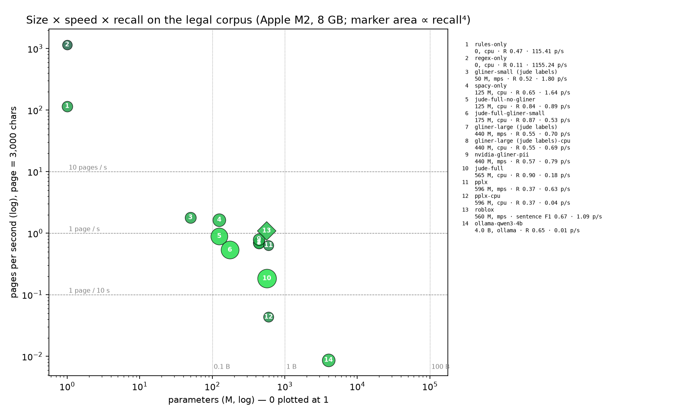

# Where the efficient point is — speed, size, and what a firm actually needs

The question, as put by a collaborator: fine-tuning a huge model will
always beat a tiny one, with steeply diminishing returns; so place the
blockers on logarithmic scales first — *one page in 10 s, one page per
second, ten pages per second; 0.1 B, 1 B, 100 B parameters* — and refine
around the operating point afterwards. This page does that in two
halves: what the demand side needs (a law firm, a lawyer bound by
professional secrecy), and what the supply side buys at each rung,
measured on the benchmark corpus.

## Units

A *page* here is 3,000 characters — about 450 words or 700 tokens of
legal English or French; a 20-page memo is 60,000 characters. The
harness measures characters per second, one runner per process, model
load excluded; pages per second is that figure divided by 3,000.

## Demand: what has to be true for a lawyer to use it

### 1. Latency, not throughput, is what a user feels

Three usage patterns, three different numbers:

| Pattern | Volume | What "fast enough" means | Pages / s needed |
|---|---|---|---|
| Interactive — one lawyer, one document, before sending it to an LLM | 2–40 pages | A spinner the user tolerates: ~5 s for a 5-page letter, under a minute for a 40-page brief | **≈ 1** per user, on the machine that runs it |
| Batch — a data room, a disclosure set, an archive | 1,000–100,000 pages | Overnight | 10,000 pages in 8 h = **0.35** sustained |
| Firm-wide peak — a shared server | 300 fee-earners, a third active in the same hour, 20 pages each | Nobody queues | 1,800 pages/h ≈ 0.5 average, **≈ 2–5** at peak |

So the log ladder reads: **0.1 page/s** is tolerable on a laptop with a
progress bar (a 40-page brief in seven minutes — annoying, not
blocking); **1 page/s** is comfortable single-user; **10 pages/s** is a
firm-scale shared server. Nothing in a law firm needs 100 pages/s.
Throughput is almost never the blocker; the blocker is *where* the
computation is allowed to run.

### 2. Where it may run

Professional secrecy (Belgian Art. 458 Code pénal, the French *secret
professionnel*, GDPR Art. 28) does not forbid computation; it forbids
disclosure. Three tiers pass that test, with very different budgets:

| Tier | Typical hardware | Model budget | Who |
|---|---|---|---|
| Laptop | Apple M-series, 8–16 GB unified memory; Windows laptops without a GPU | Encoders ≤ ~1 B (bf16), quantised LLMs ≤ 4 B; CPU-only inference must remain acceptable | Solo practitioners, small firms — the majority of the bar |
| Firm server | CPU-only 64–256 GB (most mid-size firms); one or two GPUs at the larger ones (Latham & Watkins bought NVIDIA servers in 2026) | Encoders ≤ 1 B on CPU with batching; LLMs 7–14 B on one GPU; 70 B needs several | Mid-size and large firms |
| EU sovereign cloud (OVH, Scaleway; not under the US CLOUD Act) | Rented GPU instances | 70–100 B possible — but "local" has become a contract rather than a machine, and every page has a price | Large firms with an IT function willing to sign the DPA |

**100 B on premises is out for all but a handful of firms**, and — see
the supply side — it is not needed for the extraction task. Anything
that must run on the majority tier has to be ≤ 1 B and fast on CPU.

### 3. What a lawyer will and will not pay for

The asymmetry that shapes everything: a missed identifier is a
potential breach of professional secrecy — liability, reputational
harm, possibly a bar complaint. An over-redaction is a worse answer
from the LLM and some review time. The two errors are not symmetric,
so F1 is the wrong objective. The objective is:

* **recall → 1**, with the residual closed by a *cheap, fail-closed
  review* — the unverified-term report puts every capitalised term the
  detector did not touch in front of the lawyer, who reviews anyway;
* **precision high enough that the LLM's answer stays useful** — the
  *public-body over-redaction* metric: a memo in which every mention
  of the Commission or the DMA reads `Org7` is not "safe", it is
  useless;
* **review cost bounded** — of the order of ten items per page, a
  minute of attention.

Would a lawyer accept "100 % recall at any cost" — a 300 B model, or a
system that redacts half the words? No. A 300 B model at one page per
ten seconds on a €50,000 server is not the answer when a 0.5 B encoder
plus rules plus a review report reaches recall 0.998 on the tuning set;
and a system that over-redacts destroys the reason for sending the
document to an LLM at all. What the lawyer accepts is (i) a review
step — there is one anyway, it is the job — and (ii) false positives
up to the point where the answer degrades. The operating point is
therefore: **recall ≥ 0.99 by machine, precision ≥ 0.85, public-body
over-redaction ≤ 5 %, ≤ 10 review items per page, ≥ 1 page/s on the
majority tier.**

## Supply: what each rung of the size ladder buys

Measured on the benchmark corpus with the same harness, one runner per
process, on an Apple M2 with 8 GB (a deliberately modest machine — the
majority tier). *This section is filled from `benchmark/results/`;
the numbers below are the current run.*

<!-- LADDER_TABLE -->
| Runner | Params | Device | Pages / s | s / page | Recall | Precision | F1 | Public-body over-redaction | Peak RSS |
|---|---|---|---|---|---|---|---|---|---|
| `rules-only` | 0 | cpu | 115.41 | 0.0 | 0.473 | 0.950 | **0.632** | 2% | 290 MB |
| `regex-only` | 0 | cpu | 1155.24 | 0.0 | 0.111 | 0.949 | **0.198** | 0% | 289 MB |
| `gliner-small-v2.1-jude-labels` | 50 M | mps | 1.80 | 0.6 | 0.524 | 0.728 | **0.610** | 19% | 1466 MB |
| `spacy-only` | 125 M | cpu | 1.64 | 0.6 | 0.652 | 0.672 | **0.661** | 27% | 1234 MB |
| `jude-full-no-gliner` | 125 M | cpu | 0.89 | 1.1 | 0.837 | 0.689 | **0.756** | 21% | 1300 MB |
| `jude-full-gliner-small` | 175 M | cpu | 0.53 | 1.9 | 0.872 | 0.684 | **0.767** | 24% | 1834 MB |
| `gliner-large-v2.1-jude-labels` | 440 M | mps | 0.70 | 1.4 | 0.548 | 0.686 | **0.609** | 25% | 2792 MB |
| `gliner-large-v2.1-jude-labels-cpu` | 440 M | cpu | 0.69 | 1.4 | 0.548 | 0.686 | **0.609** | 25% | 3435 MB |
| `nvidia-gliner-pii-native` | 440 M | mps | 0.79 | 1.3 | 0.573 | 0.649 | **0.609** | 16% | 1865 MB |
| `jude-full` | 565 M | cpu | 0.18 | 5.4 | 0.900 | 0.688 | **0.780** | 24% | 2494 MB |
| `pplx-pii-masking` | 596 M | mps | 0.63 | 1.6 | 0.373 | 0.906 | **0.528** | 2% | 361 MB |
| `pplx-pii-masking-cpu` | 596 M | cpu | 0.04 | 23.0 | 0.373 | 0.905 | **0.529** | 2% | 1363 MB |
| `roblox-pii-classifier` | 560 M | mps | 1.09 | 0.9 | — | — | **—** | — | 750 MB |
| `ollama-qwen3-4b` | 4.0 B | ollama | 0.01 | 115.2 | 0.652 | 0.520 | **0.579** | 46% | 281 MB |
<!-- /LADDER_TABLE -->

<!-- LADDER_CHART -->

<!-- /LADDER_CHART -->

### Reading the curve

Numbers are the 44-document corpus (both splits); the held-out
figures are in `benchmark-pii-models.html`. Five things the ladder
says, in order of surprise:

1. **Quality is not monotone in parameters.** Zero parameters, well
   designed (`rules-only`: regex, long-tail patterns, known entities,
   whitelist) scores F1 0.74 with precision 0.96 — four points behind
   the full pipeline and above every neural model run alone, including
   the 440 M GLiNER (0.61) and the 596 M `pplx` (0.62). The same 440 M
   checkpoint gains three points once fine-tuned on PII data
   (`nvidia-gliner-pii`, 0.64): at equal size, *what the model was
   taught* is worth more than *how big it is*.
2. **The model's job is recall; the rules' job is precision.** Rules
   alone recall 0.60; adding the neural layers takes Jude to 0.91 —
   +31 points — at a cost of 27 precision points (0.96 → 0.69). That
   is the division of labour the numbers impose, not a design
   preference. Numbers follow the annotation rulings of 13 October
   2026 (bare cities and codenames are not identifiers), which the
   detector implements since v0.8.1.
3. **Diminishing returns start at 0.1 B.** Inside the same pipeline,
   GLiNER small (50 M) gives F1 0.774 / recall 0.883; large (440 M)
   gives 0.785 / 0.910. Nine times the parameters buy one point of F1
   and 3 of recall — and cost 3× the time per page (0.54 → 0.18
   pages/s). No GLiNER at all: 0.760 / 0.846 at 1.0 page/s.
4. **Architecture beats size for the CPU tier.** GLiNER large runs
   almost as fast on CPU as on the GPU (0.72 vs 0.94 pages/s);
   `pplx`'s Qwen-derived encoder of similar size drops from 0.70 to
   **0.04 pages/s** on CPU — 23 s per page, 17× slower. For the
   majority tier (no GPU) the model family decides deployability.
5. **Generative extraction is a different order of magnitude — and
   not better.** A 4 B chat model through Ollama (`qwen3:4b`, thinking
   off, JSON output) needs about 115 s per page on the same machine
   (0.009 pages/s at 18 tokens/s; one document abandoned after two
   thirty-minute timeouts), for F1 0.58 — recall 0.65, precision 0.52
   — and it redacts **44 %** of public-body mentions: told not to list
   institutions, it lists them anyway. On the held-out split it scores
   0.544, below the 440 M NVIDIA encoder (0.628) and well below the
   rules alone (0.714). A 7–14 B model may still earn a place as an
   occasional second reader for quasi-identifiers; as the extractor,
   the generative route costs a hundred times the compute for a
   worse answer.

Jude's own pipeline is the slowest encoder on the chart (0.18 pages/s)
for a reason unrelated to model size: two full passes and a
transformer spaCy on CPU. Its throughput is an engineering item, not
a modelling one.

## The efficient point

Read against the demand side above:

* **Size: 50–450 M, encoder.** Everything a laptop tier needs; the
  50 M variant already delivers 97 % of the large one's recall inside
  the pipeline. What the extra parameters cannot buy — organisations
  as parties, public bodies as negatives, case references, the long
  tail — training data can: the six points the NVIDIA fine-tune gains
  at equal size is the lower bound of what a *legal* fine-tune should
  bring, since its label set finally matches the task.
* **Speed: ≥ 1 page/s on CPU is within reach** for a single-pass
  50–450 M encoder; Jude's 0.18 pages/s is the two-pass pipeline, not
  the model. 10 pages/s is a server with batching, or the rules layer
  alone (117 pages/s) for a first triage.
* **Quality target: recall ≥ 0.99 by machine with the review report
  closing the gap, precision ≥ 0.85, public-body over-redaction
  ≤ 5 %.** On the held-out split Jude stands at recall 0.89 / precision
  0.64 / over-redaction 26 % — the gap is almost entirely the negative
  classes: the public sphere in French practice, role phrases,
  published citations and bare short forms — what a model has to
  *learn to leave alone*, not what it has to find (see the failure
  taxonomy in `benchmark-pii-models.html`).
* **100 B: not on the frontier.** Off every deployment tier a firm
  can own, and the task does not need it; a 7–14 B local model earns
  its place only as an occasional second reader for quasi-identifiers.

So the model worth training is small: a 50–100 M encoder (GLiNER
small/medium class) fine-tuned on synthetic legal documents with the
label schema in `training-data.html`, evaluated on the held-out split.
If it holds 95 % of the large model's recall — the hypothesis the
ladder makes plausible but has not yet tested — it runs on every
laptop at a page a second, and the rules and the review report do the
rest.
